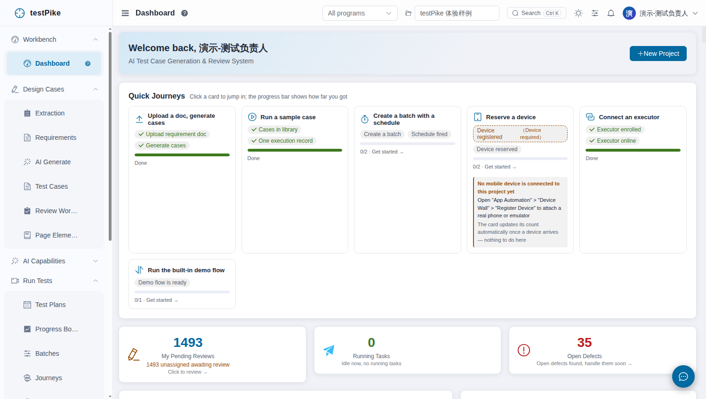
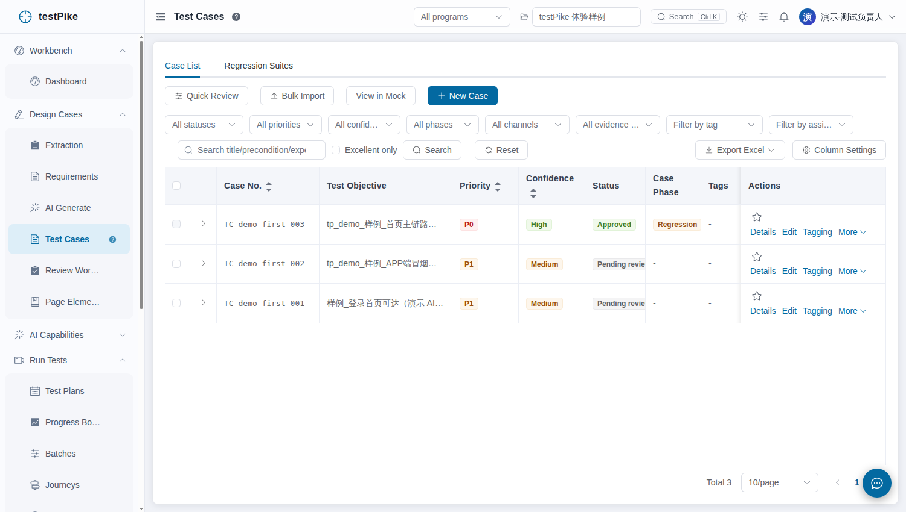

# testPike — the self-evolving AI test platform

> English | **[简体中文](README.zh-CN.md)**

[](https://github.com/6bean/testpike/actions/workflows/ci.yml)
[](https://github.com/6bean/testpike/releases)
[](LICENSE)
[](https://github.com/6bean/testpike)
[](https://github.com/6bean/testpike)
[](https://github.com/6bean/testpike)
[](CONTRIBUTING.md)
[](https://github.com/6bean/testpike/labels/good%20first%20issue)

testPike turns requirement documents into structured test cases and executable scripts, runs them
on real browsers, real devices and real load engines, and learns from every review and every
failure. One closed loop: **requirements → AI generation → human review → real execution →
operations & governance → feedback back into prompts, skills and samples.**

Java 21 microservices · Vue 3 console · Python 3.11 + Playwright executor cluster ·
pgvector knowledge · MCP in both directions · runs fully offline on a built-in mock LLM.

```
 requirement docs ──AI extraction (evidence-anchored ledger)──▶ requirement points
 requirement points ──AI generation (cost estimate → confirm)──▶ cases
 cases ──review workbench (flowchart sync, quick keys)──▶ approved cases
 approved cases ──script engine (action JSON, locator strategies)──▶ executable scripts
 scripts ──executor cluster──▶ Web UI · API · mobile · performance runs
 results ──▶ reports, defects, cost ledger ──▶ feedback / learning / self-evolution
```

## Screens

| Dashboard with guided first-run journeys | Reviewed, versioned case library |
| --- | --- |
|  |  |

*Captured from a live stack running the built-in mock LLM (no external API key); the project shown is the
factory demo project that ships with the first-install seed.*

## Features

### Requirements & case design
- Ingest Markdown/PDF requirements; AI extraction into requirement points with a per-chunk
  evidence ledger (re-extraction diffs against the previous version, a review queue for changed
  or missing items, and a preview that never silently drops what the source said)
- Requirement register: versioned requirement points with lineage documents → requirements → cases
- AI case generation: single or batch (50 per run by default, hot-configurable) with cost
  estimation before you confirm; coverage gap-filling; style adaptation to your existing case
  library; near-duplicate hints; scenario circle-selection that defaults to full enumeration
  (multiple cases per requirement point)
- Structured output: steps, preconditions, priority and confidence suggestions, tags,
  per-endpoint attributes (web / mobile / POS)
- Review workbench: quick-key and batch review, flowchart generation with bidirectional
  description ↔ flowchart sync, structured reject reasons that feed the learning loop
- Case governance: field-level version history with diff and rollback, clone, tagging,
  assignment, recycle bin; traceability views (requirement → case → script → execution → defect)
- Web element ledger: a shared, reusable registry of page elements feeding locator strategies

### Scripts & real execution
- Approved cases auto-convert to executable action-JSON with locator-strategy generation;
  dry-run validation; L1 failure self-healing; codegen normalization
- Dual-mode editor: drag-and-drop step tree with loop/if control flow, and source mode with
  live diff preview
- Assertions: visual regression (baselines confirmed by a human) plus non-UI primitives —
  console, network, HTTP and SQL — with contains/exact/regex/range matchers
- Executor cluster protocol: register → heartbeat → claim → execute → report back, with
  process-level isolation per task (reliable timeout kill, immune to lost browser sessions)
- Browser matrix per environment (chromium / firefox / webkit); screenshots and artifacts on
  S3-compatible object storage (SeaweedFS ships in compose; point `S3_ENDPOINT` at any cloud S3)
- Scheduling & resilience: batch checkpoint/resume, watchdog, crash recovery, single-case rerun,
  quick one-off execution; flaky detection & quarantine
- Autonomous page exploration (agentic mode) with hard step/token/time budgets and
  evidence-to-draft pipelines

### API testing, contract mocks & orchestration
- API testing workbench: collections, five auth types plus signature presets, JSON Schema
  validation, WebSocket assertions, collection-level auth/default-header inheritance with an
  effective-value preview, response diffing, and CI-gate verdicts
- API inventory & contract change analysis: spec import, endpoint ledger, changed-contract impact
  queues pointing at affected cases and mocks
- Mock server: contract-driven mock spaces generated from your API specs — deterministic matching
  with examples, optional AI fallback for unmatched traffic (honestly labeled, inspectable,
  never silently fabricated)
- Flow orchestration: ordered API journeys with templates, one-click promotion to reusable
  flows, and cross-project test journeys spanning several systems

### Performance testing
- Three engines — Gatling (default), k6, JMeter — installed or swapped through installer
  engine descriptors
- Scenario wizard, live run pages with streaming metrics, in-flight SLA circuit breaker and a
  kill switch, version-to-version report comparison
- Promote an API test into a performance scenario in one click; results feed the same
  report and defect pipelines

### Mobile app automation
- Device wall and reservation calendar; shared devices across projects with leases and write locks
- Android real devices / emulators attached to enrolled executors; engine center with pluggable
  platform adapters (a frozen device-adapter contract for HarmonyOS NEXT is on the roadmap track)
- App packages, mobile element library, popup-rule handling, flow-canvas editing, step-level AI
  healing, AI sample board; crash-scene step sequences captured in run reports; budgeted
  app auto-exploration

### AI copilot & self-evolution
- A chat dock on every page: streaming frames with heartbeat and honest degradation, pin-to-keep
  mode, unread badge, session library (search, paging, restore); `@` references pull skills and
  tools into context
- Draft cards: the assistant can create/edit cases, requirements, scripts, plans and more — every
  write lands as a reviewable draft with a one-click accept; nothing writes to your data without
  that confirmation
- Grounded answers: citations deep-link into help chapters and knowledge entries; paste a
  screenshot or an Excel table (converted to Markdown) straight into the conversation;
  failure screenshots go to the multimodal model for diagnosis
- Project knowledge base on pgvector (semantic retrieval fused into generation prompts),
  with rebuild and ledger reconciliation
- SKILL definitions with approval flow and a marketplace; a tool registry with a generic ToolSPI
  and a function-calling consumption chain (HTTP callback, executor sandbox, or MCP bridge);
  write tools guarded by one-shot confirmation tickets
- MCP both directions: connect external MCP servers as tools, and expose testPike as an MCP
  server so external coding agents can drive the full feature surface
- Learning loop: quality feedback capture, wording adoption injection, training-sample collection,
  prompt templates with versioning / canary traffic / rollback, and a self-evolution ring where
  the AI proposes its own prompt improvements with one-click revert
- AI evaluation (judge): eval sets, runs and reports score the platform's own AI output
- Async visibility: long-running tasks show a live tail window, replayable after the run, so you
  can leave the page and still find what happened (rolling out across every async surface)
- Cost center: per-call token accounting, budget guard with circuit breaker, per-session cost
  attribution

### Test operations & insight
- Execution plans, regression suites, program (project-set) dashboard, progress board
- Report center with saved statistic definitions, scheduled weekly/monthly reports, CSV/PDF
  export and subscription blocks; batch completion cards
- Defect tracker with auto-filing suggestions on failures and JIRA sync; data factory with
  encrypted data pools; site & API monitors; environment and deployment status tracking
- Notification center: in-app, webhooks, Feishu interactive cards (with callback gates); review
  reminders; daily digest; dead-letter operations ledger with governed replay
- Configurable data retention; audit trail with integrity checks

### Platform & governance
- Multi-project with tenant-level data isolation, project-scoped knowledge/style/environment
  config; RBAC with role templates and demo accounts; explicit delete-request approval flow
- Credential vault (encrypted, never echoed back) and login-state capture & replay
  (token / storage_state / cookie_set, including combined multi-credential sessions) for
  captcha-gated, QR-scan or SSO logins — capture is limited to your own already-logged-in
  session; captcha *solving* is explicitly not a feature
- Security: prompt-injection protection, permission-intersection re-checks at execution points,
  login lockout, password policy, dual-token session rotation, environment health checks
- Cluster management: executor pools and queue water levels, upgrade center with canary
  rollout, fleet autoscaling decision core (bare-metal agent enrollment today; K8s/Helm shape
  on the verification track)
- Industry plugin framework (POS/ERP descriptor samples) and CI/CD integration endpoints
  (runs API + status badges, `cli/` trigger tool)
- OpenAI-compatible LLM provider adapter with centralized key management (AES); a built-in mock
  LLM keeps the whole product runnable with zero external API
- i18n (simplified Chinese / English), dark (default) and light themes, `Ctrl/⌘+K` global search
  including menu synonyms, per-page help chapters

**Delivery status:** the requirement traceability matrix tracks **202 feature points — 197 carry
completion evidence**; the remainder are in development or scheduled.

## Roadmap

In progress
- Whole-site survey: give one URL and recursively crawl an entire site into a site profile
  (path-based project segmentation, login-wall detection), feeding exploration and case generation
- Process-window replay on every remaining async surface (leave-and-return progress visibility)
- Extraction-chain throughput hardening (large-document runs from hours toward minutes without
  loosening fidelity guards)

Planned / on track
- Training-data masking pipeline for model fine-tuning
- Mobile real-device fleet expansion and the HarmonyOS device adapter
- Per-browser recording generation across the full browser matrix
- K8s-native autoscaling live verification
- Incremental case generation and one-click regression batches on requirement-document updates

## Architecture

| Module | Role | Port |
| --- | --- | --- |
| `admin` | user-facing API gateway (auth, workbench, CRUD facades) | 8081 |
| `api` | machine-facing integrations (CI/CD, executor protocol, MCP server) | 8082 |
| `core` | service layer — domain logic, data, scheduling (consumed via Feign by admin/api) | 8083 |
| `ai-service` | AI orchestration — LLM/embedding clients, generation & review pipelines | 18084 |
| `mock-server` | contract-driven API simulator — see [mock-server/README.md](mock-server/README.md) for a sample-spec quick start | 18085 (mgmt) / 18086 (traffic) |
| `common` | shared primitives (Response, exceptions, validation) | — |
| `executor` | Python cluster: browser, app, API and perf task types (register/heartbeat/claim/result) | — |
| `frontend` | Vue 3 + TypeScript + Element Plus console | 5173 (dev) |
| `installkit` | guided installer, resource tiers, engine descriptors, fleet enrollment | — |
| `cli` | CI trigger client (runs API + status badges) | — |

Infrastructure: PostgreSQL 16 + pgvector (host 15432), Redis 7 (6380), RabbitMQ 3 (5672),
SeaweedFS S3 gateway (8333; metadata in a dedicated PostgreSQL database) — all provided by
`docker compose`; Prometheus/Grafana join on the `full` tier. Request flow: frontend → admin →
Feign → core / ai-service; async work runs over RabbitMQ; artifacts move via S3 presigned URLs
(SigV4). Every host port is remappable through `.env`.

## Installation

New users: follow the step-by-step [INSTALL.md](INSTALL.md) — prerequisites, wizard scenarios,
`.env` configuration, database initialization, first login, and a post-install acceptance
checklist ([简体中文版](INSTALL.zh-CN.md)). The summary below covers the same ground in brief.

### Guided installer (Linux / macOS / WSL)

```bash
bash installkit/install.sh --scenario=first
```

The first-run wizard asks a few questions, then installs the stack step by step. Every step is
idempotent (already-installed components are detected and skipped), an interrupted run resumes at
its checkpoint, and full logs land in `~/.testpike-installkit/logs/`. `--scenario=repair` runs a
health check that fills missing pieces in place.

Three resource tiers (disk/RAM figures are summed programmatically from the component matrix —
not hand-written; pass `--tier=lightweight|standard|full` to skip the question):

| Tier | Components | Disk | RAM |
| --- | --- | --- | --- |
| `lightweight` (default) | PostgreSQL / Redis / RabbitMQ / SeaweedFS + backend services | 2700 MB | 3968 MB |
| `standard` | + web console served by nginx (compose profile `app`) | 2900 MB | 4032 MB |
| `full` | + Prometheus / Grafana observability + Playwright executor | 4587 MB | 4864 MB |

Prerequisites: Docker with the Compose plugin, plus `git`, `curl` and `python3` (with `pip`) on the
host — the wizard checks them first and names exactly what is missing and how to install it.
Windows hosts use `installkit/install.ps1` (same scenario grid). `--unattended` runs the whole flow
with default answers on the same code path, so CI pipelines never hang on a prompt.

Other entry points: `--scenario=scale-out` enrols another machine into the executor pool with a
one-time token; `--scenario=scale-in` drains first and removes only what installkit itself
installed; `--scenario=engines` adds or swaps load-test engines from descriptors. Every
install-time value (ports, database name, object bucket, message vhost, thresholds) is read from
the project-root `.env` — see `.env.example` for the key set with shipped defaults; edit `.env`,
never the scripts.

Mobile (Android) journeys additionally require a real device or an emulator attached to an enrolled
executor; API/web journeys run without any device.

> Open-source installer policy: the wizard follows common open-source platform conventions
> (one-command bootstrap, idempotent steps, programmatically summed resource tiers). Design ideas
> were reviewed from projects such as TestHub, but no GPL-licensed source code is copied — every
> file under `installkit/` is an original implementation of this repository.

## Quick Start

### 1. Infrastructure (Docker)

```bash
docker compose up -d      # PostgreSQL 16 (host 15432) + Redis (6380) + RabbitMQ (5672) + SeaweedFS (8333)
```

### 2. Backend (JDK 21 + Maven)

```bash
# compile everything
mvn -q compile
# unit tests (per module)
mvn -pl core test
# run services (from each module directory)
mvn spring-boot:run       # admin:8081 / api:8082 / core:8083 / ai-service:18084
```

> Environment variables: start with `cp .env.example .env` (sample values match the docker compose
> development credentials, so it works out of the box); the app reads them from the project-root `.env`
> (never inline secrets; load via `set -a && source .env && set +a`). `.env` is gitignored and never committed.
> Database initialization: fully automatic for a fresh install — the first `docker compose up -d` on an empty
> data volume runs `db/schema-init.sql` (the full incremental-migration history merged with seed data:
> ≈2.2 MB, 199 tables). To rebuild from an existing volume: `docker compose down -v && docker compose up -d`.
> Upgrading an existing database is one command — `bash installkit/install.sh --scenario=upgrade`
> applies the incremental `db/migration/` scripts through the migration ledger
> (Flyway is not enabled). `db/schema-init.sql` is a generated artifact — regenerate it with
> `bash tools/ops/gen_schema_init.sh` after adding migrations; do not edit by hand.
> LLM: with `LLM_MOCK_ENABLED=true` (default) a built-in mock provider keeps everything runnable with no
> external API; switch it off and point `LLM_BASE_URL` / `LLM_API_KEY` at any OpenAI-compatible gateway.

### 3. Frontend (Vue 3)

```bash
cd frontend
npm install && npm run dev     # http://localhost:5173
npm run build                  # production build (use NODE_OPTIONS=--max-old-space-size=4096 to avoid OOM)
npx vue-tsc --noEmit           # type check
```

### 4. Executor (Python 3.11, real browser execution)

```bash
cd executor
pip install -r requirements.txt
python3 runner.py              # register → heartbeat → claim → subprocess execution → report back
```

> `python3 serve_fixtures.py &` starts local demo target pages (port 8899) so you can run scripts end-to-end
> without a real application under test.

## Versioning

testPike follows semantic versioning and stays in `0.x` while the public interfaces are still evolving:

- **Major 0** - no backward-compatibility promise across releases. Database schema, HTTP API surface and config keys may change between minor versions; read the release notes before upgrading.
- **Minor (`v0.1` -> `v0.2`)** - cut when backward-compatible feature batches (new user-facing capabilities) land on a release snapshot whose CI is fully green.
- **Patch (`v0.1.0` -> `v0.1.1`)** - bug fixes only, no new user-facing capabilities; also cut only on a fully-green snapshot.
- The GitHub tag is the single source of truth for a released version. Maven `<version>` and `frontend/package.json` carry the next planned version (`-SNAPSHOT` suffix on `main`); the suffix is dropped when the tag is cut.
- Release gate: a version tag and its Release page are created only after the pushed snapshot passes every CI job. Interim build candidates are not kept as permanent tags.

## Documentation & community

- [INSTALL.md](INSTALL.md) / [INSTALL.zh-CN.md](INSTALL.zh-CN.md) — guided install and acceptance checklist
- [CONTRIBUTING.md](CONTRIBUTING.md) — how to file issues, send patches and add skills/tools
- [Good first issues](https://github.com/6bean/testpike/labels/good%20first%20issue) — a curated entry point for first contributions
- [SECURITY.md](SECURITY.md) — vulnerability reporting and the security invariants we hold
- [CODE_OF_CONDUCT.md](CODE_OF_CONDUCT.md) · [NOTICE](NOTICE) — third-party attribution ledger

## License

Apache License 2.0 (see [LICENSE](LICENSE))
